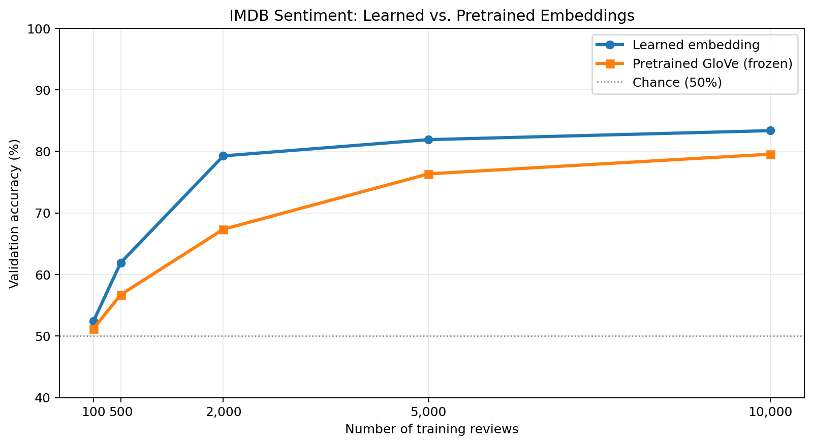

# Assignment 4 — IMDB Sentiment Classification

## Research objective

Compare the validation accuracy of a bidirectional LSTM sentiment classifier using (1) a trainable 100-dimensional word-embedding layer and (2) frozen pretrained GloVe 100-dimensional word embeddings. The task is to predict whether an IMDB movie review expresses positive or negative sentiment.

## Experimental design

- **Review length:** 150 tokens maximum (zero-padding for shorter inputs).
- **Vocabulary:** at most 10,000 tokens, adapted from the training subset separately at each sample size.
- **Training sizes:** 100, 500, 2,000, 5,000 and 10,000 balanced labeled reviews.
- **Validation data:** the same 10,000 held-out reviews in each comparison, with a stratified split.
- **Shared classifier:** bidirectional LSTM (16 units per direction), dropout (0.30), sigmoid output; up to six training epochs with early stopping.
- **Embedding comparison:** trainable 100-dimensional embeddings versus 100-dimensional frozen GloVe embeddings. The remaining architecture is the same.

## Observed validation results

| Training reviews | Learned embedding | Frozen GloVe | Difference (percentage points) |
| ---: | ---: | ---: | ---: |
| 100 | 52.38% | 51.19% | +1.19 |
| 500 | 61.91% | 56.71% | +5.20 |
| 2,000 | 79.26% | 67.34% | +11.92 |
| 5,000 | 81.90% | 76.34% | +5.56 |
| 10,000 | **83.36%** | **79.54%** | **+3.82** |

A learned embedding had higher validation accuracy at all five tested training sizes, including the first tested size of 100 reviews. The largest observed advantage was **11.92 percentage points** at 2,000 reviews; no crossing point was established between tested sizes.

## Interpretation and boundaries

Both methods improved when given more training examples. Learned embeddings can adapt directly to the movie-review task, whereas the GloVe vectors were held fixed; the results do not prove that this distinction alone caused the differences. All reported scores are **validation accuracies**, not results from an independent test set. These outcomes describe one sampling seed and one model configuration, not universal rankings of pretrained embeddings.

The experiment **uses LSTM sequence models rather than Transformers**. Self-attention and Transformers were covered conceptually in the course; neither was trained for these results.

## Research artifacts

- `Assignment_4_Kaggle_IMDB_Embeddings.ipynb` — documented Kaggle-compatible experimental source code (no saved execution outputs in this copy).
- `assignment4_experiment_results.csv` — ten recorded model runs, including validation accuracy, loss, training epochs, and embedding vocabulary information.
- `assignment4_comparison_table.csv` — paired validation results at each training size.
- `assignment4_accuracy_graph.png` — actual exported accuracy comparison chart.

The separate final PDF report remains under review and is **not included in this repository folder yet**.
